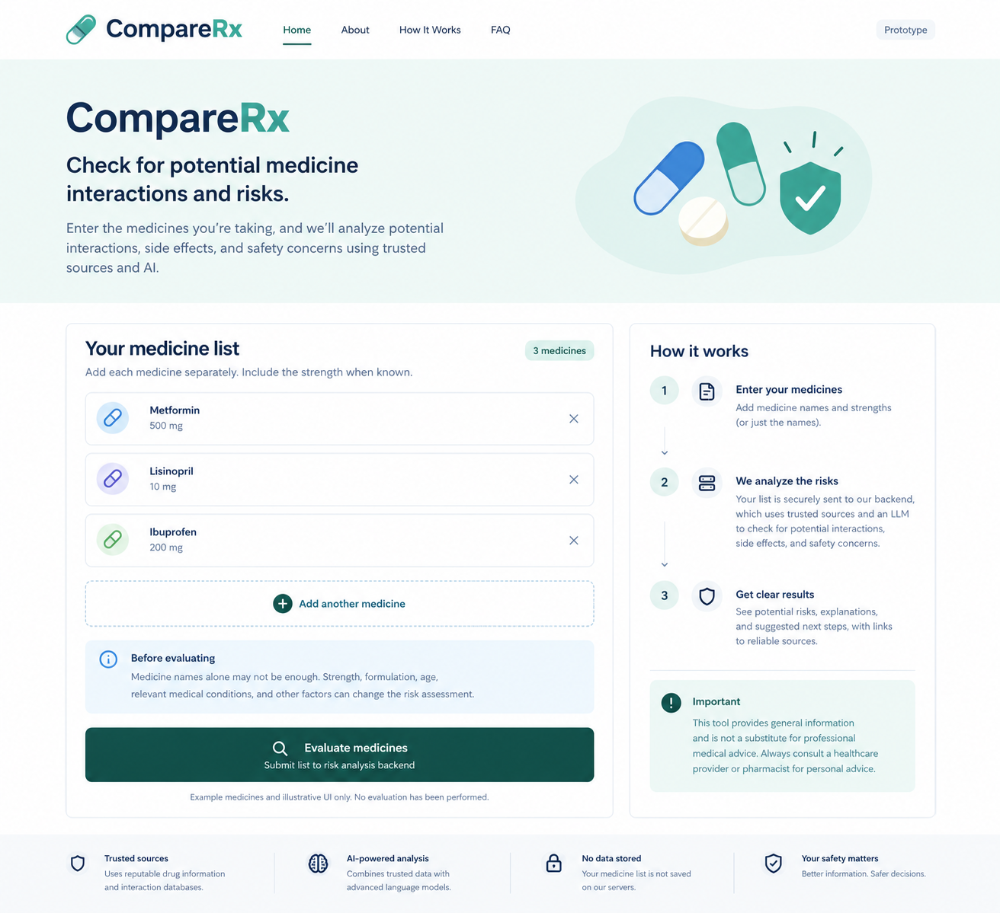

# CompareRx

A medicine interaction and risk checker for patients in India, many of them elderly.

> **Status: planning stage.** This repository holds the product plan and a UI mockup. There is no source code yet.

> **Not medical advice.** CompareRx is meant to give general information only. It does not replace a doctor or pharmacist, and every result must direct the user to one.

## The problem

When medicines are prescribed on paper (non-EMR based), nothing automatically checks the full list of medicines a patient has been prescribed. Patients often see several doctors, and each doctor prescribes without knowing what the others have prescribed. This can lead to double dosing (for example, two brands with the same active ingredient) and to unsafe combinations. Patients are left to spot these problems themselves and rarely know what to ask.

## What CompareRx will do

A patient enters their medicines (name and optional strength). CompareRx checks the list against trusted drug information and returns:

- duplicate active ingredients
- possible interactions
- plain-language explanations
- questions to ask a doctor or pharmacist
- links to the sources behind every statement

## Principles

These are product promises, and the design enforces them.

1. **No source, no answer.** Every statement must be backed by a retrievable source with an exact quote. If no source is found, the tool says "I am unable to find the answer" instead of guessing.
2. **No data stored.** Medicine lists (and later, images) are never saved or logged. Saving medicines per user will be implemented in a later phase, opt-in only (see [design decision D11](docs/design-decisions.md)).
3. **Always refer to a professional.** A fixed disclaimer is added to every result, and the tool never says medicines are "safe" or advises changing a dose.
4. **Read, don't guess.** In the photo versions, only text visible in the image can become a medicine name, and the patient confirms every extracted medicine.

## Roadmap

| Increment | What it delivers |
|---|---|
| PoC | Prove we can give sourced answers, or an honest "unable to find", for a small set of medicines |
| Version 1 | Safe, usable launch for real users |
| Version 2 | Add medicines by photographing a medicine strip (agent-based extraction) |
| Version 3 | Add medicines by uploading a handwritten prescription (agent-based extraction) |
| Version 4 | Better matching, patient context, elderly-friendly design |
| Version 5 | Print or share results, more Indian languages, supplements and food interactions |
| Later phase (not scheduled) | Save medicines per user, opt-in only, after a privacy and legal review |

Details, steps and exit criteria are in [docs/roadmap.md](docs/roadmap.md).

## How the PoC works

1. The code looks up the patient's medicines in a trusted drug data source and retrieves passages, each with an ID.
2. A Claude model (`claude-opus-5-5`) receives only those passages and returns a structured answer, citing passage IDs and exact quotes.
3. The code verifies every ID and quote. Anything that fails verification becomes "unable to find the answer".
4. The result is shown with source links from our own records and a fixed disclaimer.

## Documentation

| Document | Contents |
|---|---|
| [docs/prd.md](docs/prd.md) | Product requirements: problem, goals, users, stories, acceptance criteria, risks, open questions, metrics |
| [docs/roadmap.md](docs/roadmap.md) | PoC to Version 5, with increments and exit criteria |
| [docs/architecture.md](docs/architecture.md) | PoC request flow and where each promise is enforced |
| [docs/design-decisions.md](docs/design-decisions.md) | Decision log with reasons |
| [docs/poc-system-prompt.md](docs/poc-system-prompt.md) | LLM system prompt, output schema and verification checks |
| [docs/evals.md](docs/evals.md) | The evals to run for each roadmap increment |
| [CLAUDE.md](CLAUDE.md) | Guidance for Claude Code when working in this repository |

## Open decisions

Still to be decided (see the open questions in the PRD and roadmap):

- Which trusted drug databases to use for Indian medicines, and their licences
- Programming language, framework and hosting
- Data retention terms of the LLM provider for our account
- Who the clinical reviewer is
- How to build a consented, anonymised test set for strip and prescription photos
- How saving medicines per user fits the "no data stored" promise (consent, sign-in, deletion, Indian health-data rules)

## Contributing

There is no code to contribute to yet. Feedback on the plan is welcome, especially from clinicians, pharmacists and people who help elderly relatives manage their medicines.

## License

Not yet chosen. Until a license is added, all rights are reserved.
